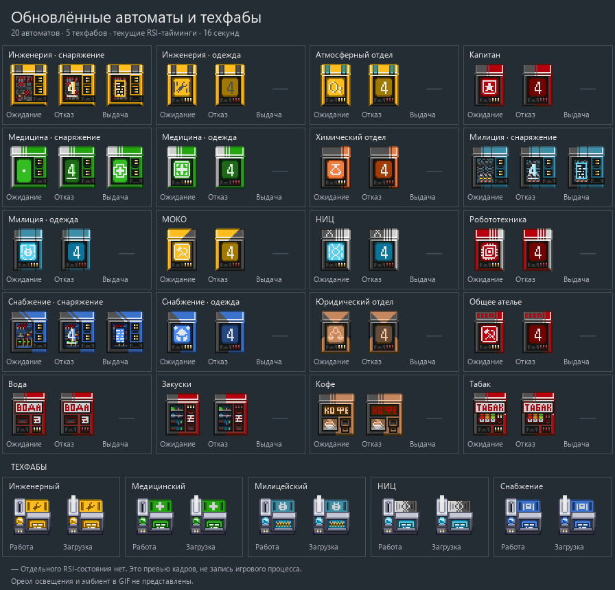

# Респрайт автоматов и техфабов, редактор ассортимента и автодеплой

## Описание PR

Обновляет внешний вид отделенческих торговых автоматов и техфабов IS14. Добавляет браузерный инструмент, в котором дизайнеры экономики могут собирать ассортимент без входа в игру, и его автоматическое обновление при публикации сборки.

- Собраны 25 RSI: 20 комплектов автоматов и 5 комплектов техфабов. Обновлены 8 существующих платных автоматов IS14 и добавлены 12 новых. Пять существующих техфабов получили новые спрайты с сохранением ID, плат и рецептов.
- Заменённые RSI перенесены в `Resources/Textures/_IS14/Obsolette`. Оставшиеся старые варианты техфабов используют перенесённый общий набор; автоматы экспедиций сохраняют прежний вид.
- Анимации получили паузы и различающийся ритм. Пустые ячейки в конце исходных листов исключены из числа кадров.
- Автоматы и техфабы получили небольшое цветное освещение и эмбиент электроники. У автоматов свет слегка мерцает и отключается вместе с питанием либо при поломке.
- Названия и описания сущностей в изменённых YAML заданы на английском; русский текст и названия вкладок вынесены в Fluent.

## Почему / Баланс

Новые комплекты унифицируют оформление отделов, а EconomyEditor позволяет готовить и обсуждать ассортимент отдельными проектами вместо ручного редактирования YAML.

Начальный ассортимент 12 новых автоматов перенесён из соответствующих игровых инвентарей, с фиксированной стартовой ценой **100 кредитов за позицию**. Это отправная точка для дальнейшей настройки, а не завершённый баланс экономики. Ассортимент и цены существующих восьми автоматов сохранены. Вкладки нового редактора позволяют отдельно настраивать цены, начальные запасы и доступы.

## Технические детали

### Спрайты и игровые эффекты

- Новые RSI расположены в `_IS14/Structures/Machines/Vends` и `_IS14/Structures/Machines/Techfabs`.
- Тайминги ожидания автоматов составляют примерно 2,9–7,4 секунды на цикл, рабочего состояния техфабов — 1,8–2,2 секунды. Загрузка материалов укладывается в существующее окно 0,79 секунды.
- Цвета источников света подобраны под светящиеся элементы спрайтов. Эмбиент использует `light_hum` у автоматов и `emf_buzz` у техфабов.
- Клиентский визуализатор платных автоматов останавливает поведение мерцания до выключения света, чтобы очередной цикл анимации не включил обесточенный автомат снова.
- Дополнительные RSI-состояния выдачи сохранены там, где они есть в исходных материалах. Их наличие в GIF демонстрирует ассеты; новая игровая логика проигрывания выдачи для платного компонента IS14 в этом PR не добавляется.

### EconomyEditor

- Отдельное ASP.NET Core-приложение в `Tools/EconomyEditor`, доступное через браузер. Проекты и история версий хранятся в SQLite; общий ключ доступа задаётся через `EDITOR_TOKEN`. Индивидуальных аккаунтов и ролей пока нет.
- Поддерживает поиск по русскому названию и ID, категории, превью спрайтов, добавление и перенос товаров, цены и запасы, вкладки и доступы, контрабанду, счета выручки и налог, копирование наполнения, массовое изменение цен и заметки.
- Сохранение проверяет ревизию проекта, поэтому устаревшая копия не перезаписывает чужие изменения. Есть локальное восстановление черновика, JSON для обмена и ZIP-экспорт для игры.
- Режим `Content.YAMLLinter --export-economy-catalog` использует производственные прототипы с разрешённым наследованием. Данные ассортимента берутся с сервера, маппинги Sprite/Icon — с клиента. Снимок содержит русскую локализацию и необходимые текстуры; его версия учитывает данные и изображения.
- Превью предметов — статические первые кадры слоёв; процедурные эффекты и игровые визуализаторы полностью не воспроизводятся. Для отсутствующих исходных изображений предусмотрена заглушка.
- `apply_project.py` сначала показывает diff. С `--apply` обновляет поля ассортимента и локализацию, сохраняя остальные компоненты и YAML-теги. Комментарии внутри переписанного компонента могут быть потеряны.

### CI/CD

- `Publish` и `Publish Testing` каждый раз создают **новый снимок из публикуемого commit**, проверяют редактор и собирают отдельный Docker-образ с приложением и каталогом.
- Деплой идёт на Docker daemon self-hosted runner только после успешного `Publish version`. По умолчанию рабочий редактор слушает `127.0.0.1:5187`, тестовый — `127.0.0.1:5188`; базы разделены.
- Новая версия сначала проверяется на временном локальном порту. После переключения повторно проверяются commit и версия снимка. Ошибка приводит к возврату предыдущего контейнера; volumes с проектами не удаляются.
- Сборка сохраняет manifest с commit игры и движка, версией снимка и именем образа. В Docker добавлен встроенный health-check без зависимости от curl.

## Медиа



[Локальная копия GIF](./vendors-and-techfabs.gif).

GIF длится 16 секунд и показывает ожидание, отказ и имеющиеся кадры выдачи 20 автоматов, а также работу и загрузку пяти техфабов. Это воспроизведение RSI-состояний с актуальными задержками, а не запись игрового процесса; ореол освещения и звук оцениваются отдельно. Ссылка на raw-файл заработает после отправки ветки в GitHub.

Воспроизвести GIF из корня репозитория (нужен Pillow):

```sh
python Tools/_IS14/render_vendors_preview.py --output Docs/_IS14/PR/2026-17-11-vendors-resprite/vendors-and-techfabs.gif
```

## Проверки

- Проверка целостности новых и архивных RSI через `Schemas/validate_rsis.py`.
- Сборка клиента и экспортёра каталога; сборка и публикация EconomyEditor.
- 3 интеграционные проверки включения, отключения и восстановления света и эмбиента у капитанского/медицинского автоматов и медицинского техфаба.
- 24 проверки API, импортёра и сценариев деплоя, включая конфликты ревизий, неизвестные предметы, сохранение посторонних компонентов, ошибки переключения и откат.
- Проверка опубликованного веб-сервиса и встроенного health-check; браузерная проверка редактирования, сохранения, экспорта, ключа доступа, переноса товаров, восстановления черновика и узкого экрана.
- Workflow проверены `actionlint`, shell-скрипты — на синтаксис.
- Реальная сборка Docker-образа и запуск деплоя на self-hosted runner локально не проверялись: Docker в среде разработки отсутствует.

## Требования

- [ ] Я прочитал(а) и следую рекомендациям проекта по оформлению Pull Request и Changelog.
- [x] Медиафайл добавлен к PR.

## Критические изменения

Перед первым запуском обновлённого Publish нужно:

1. Установить Docker на self-hosted runner и дать его пользователю доступ к Docker daemon.
2. Добавить GitHub Actions secret `ECONOMY_EDITOR_TOKEN`; при желании отдельный `ECONOMY_EDITOR_TESTING_TOKEN`.
3. Если runners несколько, закрепить нужную машину уникальным label через variable `ECONOMY_EDITOR_RUNNER`.
4. Настроить HTTPS-прокси для доступа по домену. По умолчанию сервисы привязаны к loopback.

Без Docker или ключа доступа публикация останавливается на preflight до сборки игры. При первичном переносе проектов из локальной SQLite/старого Compose-volume данные нужно мигрировать отдельно. Автоматический откат контейнера не является откатом содержимого базы.

Полная инструкция запуска, экспорта и размещения: [`Tools/EconomyEditor/README.md`](../../../../Tools/EconomyEditor/README.md).

## Список изменений

:cl:
- add: Добавлены новые отделенческие торговые автоматы и браузерный редактор их ассортимента.
- tweak: Обновлены спрайты и анимации автоматов и техфабов.
- tweak: Автоматы и техфабы получили цветное свечение и эмбиент электроники.
- fix: Мерцание автоматов отключается при поломке и потере питания.
